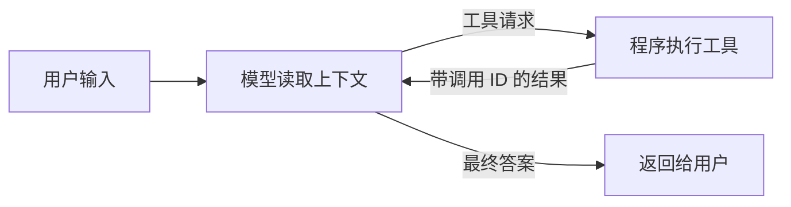

# 从零手写一个 ReAct 式 Agent

这是一份动手教程。在当前仓库里，你将用 Node.js 写一个命令行 Agent。它根据用户问题调用工具，把结果交回模型，再根据结果决定下一步。你会亲手写这段循环。第一轮学习使用本地假模型，最后才接入 OpenAI Responses API。每一课完成验收后再进入下一课。

## 我们要做出什么

用户输入「找出候选的两个城市，比较哪个更冷」。Agent 先调用 `find_cities`，从返回结果中得到两个城市，再分别调用 `get_temperature`，最后给出比较。温度和城市均来自本地固定数据，全程不需要天气 API。



图里的箭头由你的代码驱动。模型负责提出动作，程序决定允许执行哪些动作，并且保证循环能结束。练习中可以观察工具名、参数、结果和最终答案，足以解释 Agent 的外部行为。

## 准备

在当前仓库根目录打开 PowerShell。你的 Node.js 26 已经满足要求，课程只使用 Node.js 内置模块，直接运行 `.mjs` 文件。

```powershell
node --version
New-Item -ItemType Directory -Path src -Force | Out-Null
```

按课程进度创建以下文件：

| 文件 | 职责 |
|---|---|
| `src/tools.mjs` | 固定数据、工具描述、参数校验和工具分发 |
| `src/mock-model.mjs` | 返回可预测的模型响应，并检查上一轮结果 |
| `src/agent.mjs` | 手写模型与工具之间的循环 |
| `src/openai.mjs` | 用 `fetch` 调用 OpenAI Responses API |
| `src/cli.mjs` | 读取命令行问题，选择假模型或真实模型 |

## 第 1 课：先把工具写成普通函数

**任务。** 创建 `src/tools.mjs`，实现一个工具：`get_temperature`。把以下数据作为固定的练习输入：

| 城市 | 温度（摄氏度） |
|---|---:|
| 北京 | 6 |
| 杭州 | 14 |

先写好 `getTemperature(city)`，再写 `dispatchTool(name, argumentsJson)`。分发函数应导出，便于命令行直接调用。这一课的约定如下：

- `name` 必须是工具白名单里的名称。现在白名单只有 `get_temperature`。
- `argumentsJson` 是 JSON 字符串。解析后要求它是普通对象，有且仅有一个非空字符串字段 `city`。可以先对城市名做 `trim()`。
- 成功返回 `{ ok: true, city, celsius }`。未知工具、无效 JSON、参数不合法和未知城市分别返回 `{ ok: false, error: 'unknown_tool' }`、`invalid_json`、`invalid_arguments`、`unknown_city`。

**验收。** 在仓库根目录把整个代码块粘贴到 PowerShell。单引号 here-string 将 JavaScript 作为标准输入传给 Node。城市名用 Unicode 转义，兼容 Windows PowerShell 的默认管道编码。

```powershell
@'
import { dispatchTool } from './src/tools.mjs';
console.log(dispatchTool('get_temperature', JSON.stringify({ city: '\u5317\u4eac' })));
console.log(dispatchTool('get_temperature', '{'));
console.log(dispatchTool('get_temperature', JSON.stringify({ city: '\u4e0d\u5b58\u5728' })));
console.log(dispatchTool('unknown', '{}'));
'@ | node --input-type=module -
```

预期依次看到北京 `6` 度、`invalid_json`、`unknown_city`、`unknown_tool`。再自己补一条 `city: 123` 或 `city: " "`，应该得到 `invalid_arguments`。

**想一想。** 为什么模型提供了合法 JSON 以后，工具仍要校验参数和允许的工具名？

## 第 2 课：让假模型发出一次工具请求

**任务。** 创建 `src/mock-model.mjs`，导出 `async function callMock(input)`。`input` 是发给模型的上下文数组。第一次调用时，返回以下对象。这里的 `id` 是输出项 ID，`call_id` 是稍后用来匹配工具结果的调用 ID。

```js
{
  output: [
    {
      type: "function_call",
      id: "fc_mock_1",
      call_id: "call_mock_1",
      name: "get_temperature",
      arguments: JSON.stringify({ city: "北京" })
    }
  ]
}
```

第二次调用时，从 `input` 找到一个 `type: "function_call_output"` 的项，校验它的 `call_id` 为 `call_mock_1`。解析它的 `output` 字符串，然后用解析出的温度生成答案。把答案放在 `output` 数组内的 `message` 项中，其 `content` 数组包含 `{ type: "output_text", text: "北京是 6°C。" }`。收到错误的调用 ID 或缺少工具结果时抛出异常，让接线问题在本地立即暴露。

**验收。** 手工调用 `callMock` 两次。第一次拿到工具名和调用 ID，第二次传入正确的工具结果并得到答案。把传入的温度改为 `9`，答案应该随之变为 `9°C`。这可以验证假模型确实读取了工具结果。

## 第 3 课：写出 Agent 循环

**任务。** 在 `src/agent.mjs` 导出 `runAgent({ question, callModel, dispatchTool, maxRounds = 6 })`。函数内部维护一个 `input` 数组，初始内容是 `{ role: "user", content: question }`。`callModel(input)` 可以传入上一课的假模型，后面再替换成真实模型。

用带上限的循环实现以下顺序：

1. 调用 `callModel(input)`。检查返回结果，再把 `response.output` 的**所有项按原顺序**追加到 `input`。
2. 从本轮 `output` 取出 `type === "function_call"` 的项。如果本轮有工具请求，逐个调用 `dispatchTool(call.name, call.arguments)`，等待工具结果。为每个请求追加一个 `{ type: "function_call_output", call_id: call.call_id, output: JSON.stringify(result) }`，然后再次请求模型。
3. 如果本轮没有工具请求，提取本轮 `message` 的 `content` 中所有 `output_text` 的 `text` 并返回。模型有时会同时返回文本和工具请求，先完成工具分支。
4. 没有工具请求也没有最终文本时，报告模型未给出可用答案。遇到 API 失败、拒绝或 `status: "incomplete"` 时，报告相应情况。到达 `maxRounds` 仍没有最终答案时，抛出明确的轮数上限错误。

在 `src/cli.mjs` 从 `process.argv.slice(2).join(" ")` 取问题，调用 `runAgent` 并输出最终答案。空问题时提示用法。加入简短的事件输出，例如轮次、工具名称和成功状态，方便观察真实流程。

**验收。** 运行 `node src/cli.mjs '北京几度？'`，应依次看到以下输出（省略空行）：

```text
=== Round 1 ===
=== Tool: get_temperature Execution result: ok=true ===
=== Round 2 ===
北京是 6°C。
```

不传参数或只传空格时，应显示 `用法：node src/cli.mjs "你的问题"`。把 `maxRounds` 设成 `1`，确认程序以轮数上限错误结束。再把假模型的工具请求改成未知工具，确认下一轮模型能收到 `ok: false` 的结果。

**检查点。** 同轮出现多个工具调用时，每个请求都需要一条匹配的结果。对模型推理项等其他输出项，按 API 合同原样放回上下文。程序提取和展示的是工具调用与答案。 [OpenAI 工具调用指南](https://developers.openai.com/api/docs/guides/function-calling)

## 第 4 课：用两种工具验证多步决策

**任务。** 在 `src/tools.mjs` 增加 `find_cities`，接受空对象并返回 `{ ok: true, cities: ["北京", "杭州"] }`。给 `callMock` 增加一个场景，依次返回城市工具请求、两个温度工具请求、最终比较。发出两个温度工具请求前，假模型要读取 `find_cities` 的结果，并从中构造参数。

**验收。** 运行 `node src/cli.mjs '找出两个候选城市，比较谁更冷'`。第 1 轮应成功执行 `find_cities`，第 2 轮应成功执行两次 `get_temperature`，第 3 轮应输出 `北京更冷，相差 8°C`。检查第 2 轮的模型响应，确认两条温度请求使用不同的 `call_id`。反转 `find_cities` 返回的城市顺序后，温度查询也应反转，最终结论相同。第 3 课的 Agent 循环可以直接处理这一流程。

## 第 5 课：接上 OpenAI Responses API

**任务。** 先将 `.env` 写入 `.gitignore`，再创建本地 `.env`，配置 `OPENAI_API_KEY` 和 `OPENAI_MODEL`。模型 ID 使用你的账号可访问且支持工具调用的模型。在 `src/openai.mjs` 实现 `callOpenAI(input)`，使其和 `callMock(input)` 有相同的调用方式。由 CLI 用 `--real` 选择真实模型，默认走假模型。

用 `fetch` 向 `https://api.openai.com/v1/responses` 发送 POST 请求。请求头使用 `Authorization: Bearer ...` 和 `Content-Type: application/json`。请求体包含 `model`、`input`、`tools`、`store: false`、`include: ["reasoning.encrypted_content"]`，以及一条简短的 `instructions`，告诉模型何时先查候选城市、何时查温度。每轮携带当前 `input`。如果模型返回推理项，加密字段让 API 在 `store: false` 时也能接续这一轮。应用只需保留相应输出项。

`get_temperature` 的一个工具定义如下。另一个工具的 `properties` 用 `{}`，`required` 用 `[]`。

```js
{
  type: "function",
  name: "get_temperature",
  description: "使用练习数据查询指定城市的摄氏温度。",
  parameters: {
    type: "object",
    properties: { city: { type: "string" } },
    required: ["city"],
    additionalProperties: false
  },
  strict: true
}
```

如果 HTTP 状态不是成功，报告 HTTP 状态和可安全显示的错误摘要，确保输出里没有 API Key。为 `fetch` 设置有限的请求超时，例如 `AbortSignal.timeout(30_000)`。客户端解析 JSON 后把响应交给已有的循环。 [Responses API](https://platform.openai.com/docs/api-reference/responses/create) · [函数工具定义和结果回填](https://developers.openai.com/api/docs/guides/function-calling)

**验收。** 先用假模型重跑第 4 课，并确认单城问题「杭州几度？」返回 `杭州是 14°C。`。再运行真实模型。真实模型可能把两个温度调用分开，也可能放在同一轮。验收看是否先查候选、是否正确回填每条调用的结果，以及结论是否使用工具返回的数据。

```powershell
node src/cli.mjs '找出两个候选城市，比较谁更冷'
node --env-file=.env src/cli.mjs --real '请先查询候选城市，再用工具比较哪个城市更冷。'
```

## 学完怎么回看 Pi Durable 示例

用你刚写的循环看官方示例中的 `src/chat.ts` 和 `src/session.ts`。前者对应你写的模型和工具配置，后者给执行过程接上 SQLite、WebSocket 和 Alarm。你自己的 `input` 数组只能在当前进程中使用。等这个 Agent 跑通以后，再考虑把工具结果、对话和执行位置持久化，以及从哪里恢复。 [官方 Cloudflare 示例](https://github.com/earendil-works/pi-durable-cloudflare)

**现在从第 1 课开始。** 先实现 `getTemperature` 和 `dispatchTool`，运行四条验收命令。把 `src/tools.mjs` 或输出发给我，我会和你检查工具边界，再带你接入假模型。
